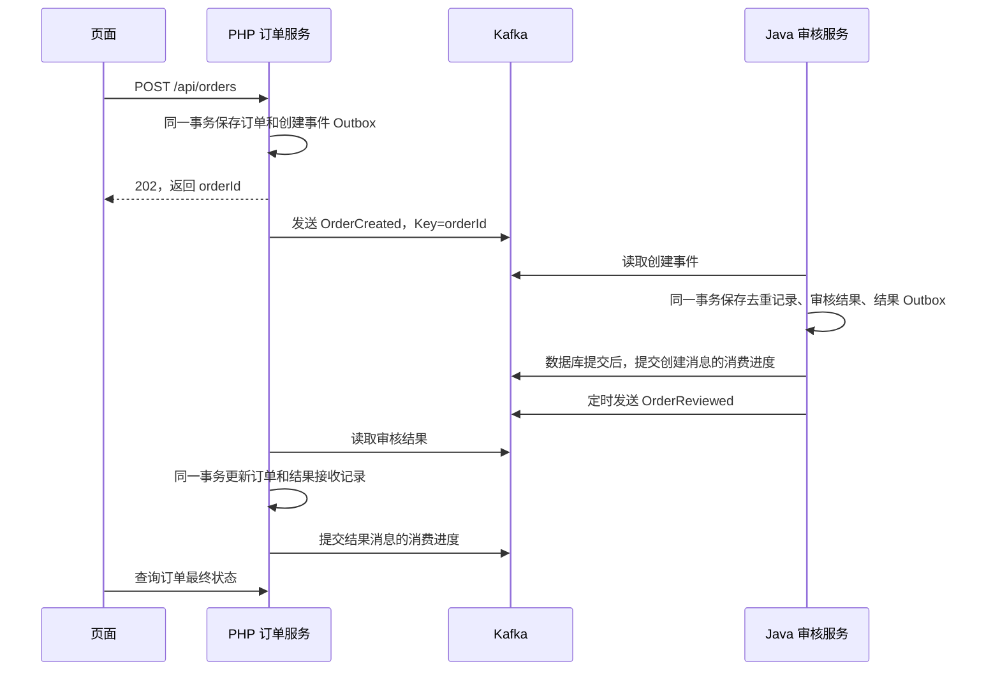

# Kafka 订单实验室

用一笔订单观察 **PHP → Kafka → Java → Kafka → PHP** 的真实链路：保存订单、选择分区、分配 Offset、消费审核、返回结果，以及失败后的重试与去重。前端可以查看消息、消费进度和日志，并按已采集的记录进行教学回放。

- [消息队列与 Kafka：从概念到可靠消息传递](docs/kafka-guide.md)
- [Java 代码阅读](java-review/README.md) · [前端使用说明](frontend/README.md)
- [本次发布检查](docs/release-review.md)

这是本地教学项目：单 Broker、单副本，两端业务按单实例处理。没有真实支付、库存、账号或权限。回放只展示记录，不修改数据库或 Kafka 消费位置。CDC、重试 Topic、死信与生产告警是文章中的扩展方案，本仓库尚未实现。

## 1. 技术栈与运行方式

| 部分 | 技术 / 版本 | 默认地址 |
| --- | --- | --- |
| PHP 订单服务 | PHP 8.4、Laravel 13、php-rdkafka 6.x、SQLite | 127.0.0.1:8000 |
| Java 审核服务 | Java 21、Maven 3.9、Spring Boot 3.5.16、JPA、H2 | 127.0.0.1:18081 |
| 消息系统 | Kafka 4.2.2（Compose 配置版本） | 127.0.0.1:19092 |
| 前端 | Node.js 24、pnpm 12.15.0、React、Vite、HeroUI、Tailwind CSS、SCSS、Zustand、TanStack Router、React Flow | 127.0.0.1:5173 |
| 本机观察服务 | 与前端一起启动，读取 API、Kafka 和日志 | 127.0.0.1:3010 |

下面优先说明 **PHP、Java、前端在本机运行**。Kafka 可以连接已有实例，也可以单独通过 Docker 启动；整套容器运行是可选方式。

```bash
git clone https://github.com/ZhaoJiSen/kafka-order-lab.git
cd kafka-order-lab
```

以下命令中的路径均相对于克隆目录，不要求放在桌面。安装命令以 macOS 为例；Linux 可安装同版本运行时，PHP 另需 SQLite、XML、mbstring、curl 等 Laravel / PHPUnit 扩展。

## 2. 安装 PHP 和 Composer 依赖

### 2.1 准备 PHP 8.4 与 Kafka 扩展

已通过 mise 等工具安装 PHP 的，可以继续使用现有版本；先用 `php -v` 确认。没有安装时，macOS 可以使用 Homebrew：

```bash
brew install php@8.4 composer librdkafka pkgconf
export PATH="$(brew --prefix php@8.4)/bin:$(brew --prefix php@8.4)/sbin:$PATH"
php -v
```

PHP 使用 `rdkafka` 扩展连接 Kafka。它是编译到 PHP 环境里的扩展，**Composer 只能检查它是否存在，不能代替 PECL 安装它**。先保证 `php`、`pecl`、`phpize` 属于同一套 PHP，再执行：

```bash
pecl install rdkafka-6.0.5
php --ini
```

若尚未启用，按安装输出，在 `php --ini` 列出的 CLI 配置文件中加入一次：

```ini
extension=rdkafka.so
```

安装时若询问 librdkafka 路径，填写 `brew --prefix librdkafka` 的输出。缺少编译工具时先安装 Xcode Command Line Tools。完成后检查：

```bash
php --ri rdkafka
php -r 'echo extension_loaded("pdo_sqlite") ? "SQLite OK\n" : "SQLite missing\n";'
composer --version
```

`php --ri rdkafka` 必须能显示扩展信息。不要用 `--ignore-platform-req=ext-rdkafka` 绕过检查后启动消息进程。[php-rdkafka 安装说明](https://php-rdkafka.github.io/php-rdkafka-doc/phpdoc/rdkafka.installation.pecl.html)

### 2.2 安装依赖和初始化数据库

在仓库根目录执行：

```bash
cd php-laravel
composer install
```

首次安装复制配置；如果已经有 `.env`，保留现有文件：

```bash
cp .env.example .env
php artisan key:generate
php artisan demo:prepare
composer check-platform-reqs
```

模板默认连接 `127.0.0.1:19092`，使用 SQLite、文件 Session 和内存 Cache。`demo:prepare` 创建 SQLite 文件并执行迁移，不需要另外安装 MySQL；不要对已有学习数据使用 `migrate:fresh`。

PHP 数据文件是 `php-laravel/database/database.sqlite`，日志是 `php-laravel/storage/logs/laravel.log`。原 Laravel Blade 页面仍保留；独立前端位于 `frontend/`，不需要运行 Laravel 自带的 Vite。

## 3. 安装 Java 和 Maven 依赖

macOS 安装：

```bash
brew install openjdk@21 maven
```

在仓库根目录执行以下命令，选择 Java 21 并下载依赖、运行测试：

```bash
export JAVA_HOME="$(brew --prefix openjdk@21)/libexec/openjdk.jdk/Contents/Home"
export PATH="$JAVA_HOME/bin:$PATH"
cd java-review
java -version
mvn -version
mvn -s settings-local.xml test
```

Linux 或其他 JDK 安装方式，把 `JAVA_HOME` 指向自己的 JDK 21。项目的 `settings-local.xml` 使用 HTTPS Maven Central，避免继承个人机器上的公司 Maven 私服配置，不修改全局 `~/.m2/settings.xml`。

Java 使用本机 H2 文件数据库，由应用启动时初始化，不需要安装数据库服务。文件位于 `java-review/.local/data/reviews.mv.db`。它和 PHP 的 SQLite 是两份独立数据库，通过消息交换业务结果。

编辑器若仍引用旧 Maven 私服，也要把 Java 插件的 Maven user settings 指向本项目的 `settings-local.xml`，再重新导入项目。

## 4. 安装 Node.js 和前端依赖

先按 [nvm 官方说明](https://github.com/nvm-sh/nvm#installing-and-updating) 安装并加载 nvm，再在仓库根目录执行：

```bash
cd frontend
nvm install
nvm use
npm install --global pnpm@12.15.0
pnpm install --frozen-lockfile
```

`.nvmrc` 指定 Node.js 24。这里只为 Node 24 安装 pnpm，不需要更改 nvm 的全局默认版本。锁文件使用 `pnpm-lock.yaml`，不要混用 npm / Yarn 安装项目依赖。

## 5. 准备 Kafka 和两个 Topic

### 已有 Kafka

创建两个 Topic，每个 3 个分区；以下命令在 Kafka 安装目录执行，把地址替换成实际地址：

```bash
bin/kafka-topics.sh --bootstrap-server 127.0.0.1:19092 --create --if-not-exists --topic demo.orders.created --partitions 3 --replication-factor 1
bin/kafka-topics.sh --bootstrap-server 127.0.0.1:19092 --create --if-not-exists --topic demo.orders.reviewed --partitions 3 --replication-factor 1
```

没有 Kafka 又不想使用 Docker，可以按照 [Kafka 官方快速入门](https://kafka.apache.org/42/getting-started/quickstart/) 安装并启动本机 Broker，再运行上面的建 Topic 命令。若监听 `9092`，需要同步修改 PHP `.env`、Java 启动环境和前端 `.env` 中的 `KAFKA_BROKERS`。Broker 的 advertised listener 必须是客户端能够访问的地址。

### 可选：只用 Docker 启动 Kafka

在仓库根目录执行。临时的 `APP_KEY` 只用于通过 Compose 的配置校验，本命令不启动 PHP：

```bash
APP_KEY=unused-for-kafka-only docker compose up -d --no-build kafka topics
```

容器的外部地址是 `127.0.0.1:19092`，内部地址是 `kafka:9092`。本机 PHP 和 Java 应使用外部地址，避免把 `localhost` 解析到未监听的 IPv6 地址。

## 6. 启动程序：分别保留五个终端

Kafka 正常运行后，按下表启动。所有工作目录相对于仓库根目录：

| 终端 | 工作目录 | 命令 | 职责 |
| --- | --- | --- | --- |
| 1 | php-laravel | `php artisan serve --host=127.0.0.1 --port=8000` | 保存 / 查询订单 |
| 2 | php-laravel | `php artisan demo:publish-outbox` | 把创建事件发送到 Kafka |
| 3 | php-laravel | `php artisan demo:consume-results` | 消费 Java 结果并更新订单 |
| 4 | java-review | `./dev.sh` | 消费订单、审核、定时发送结果 |
| 5 | frontend | `nvm use`，随后 `pnpm dev` | 同时启动观察服务和 Vite |

PHP 的三个进程共用一套代码和 SQLite，只有 HTTP 服务监听 8000。Java 的监听器和 Outbox 定时任务运行在同一个 Java 进程中。

打开 **http://127.0.0.1:5173**。创建总额不超过 1000 元的订单会通过，超过 1000 元会拒绝。

若地址不同，在 `frontend/` 复制 `.env.example` 为 `.env` 后修改对应地址，再重启 `pnpm dev`。Java 可用 `KAFKA_BROKERS=127.0.0.1:9092 ./dev.sh` 指定其他 Broker。修改 PHP 配置后执行 `php artisan config:clear`，并重新启动两个 PHP 常驻命令。

已经启动的服务不需要重复启动。分别在原终端按 `Ctrl+C` 停止进程；修改常驻进程代码后也要重启。PHP 8000 被占用时可能自动改为 8001，应核对输出，再同步修改 `frontend/.env` 的 `PHP_API_URL`。

## 7. 一笔订单怎样流转



`OrderCreated` 与 `OrderReviewed` 是两件事，具有不同的 `eventId`，沿用同一个 `orderId`。发送同一份 Outbox 消息时复用已保存的 `eventId`。两个 Topic 的分区和 Offset 分别计算；相同 Key 跨 Topic / 客户端不要求落入相同编号分区。

优先按下面顺序阅读：

1. `php-laravel/routes/api.php` → `app/Services/OrderService.php`：请求幂等、订单与 Outbox 的本地事务。
2. `php-laravel/app/Console/Commands/PublishOutbox.php` → `app/Services/KafkaProducer.php`：批量查待发送事件、等待写入确认。
3. `java-review/src/main/java/demo/order/messaging/OrderCreatedListener.java` → `service/ReviewService.java`：消费、审核、事务和去重。
4. `java-review/src/main/java/demo/order/messaging/OutboxPublisher.java`：发送审核结果。
5. `php-laravel/app/Services/ReviewResultHandler.php` → `app/Console/Commands/ConsumeResults.php`：更新订单，再提交进度。

## 8. 不打开前端也能验证

创建订单时请使用新的 `Idempotency-Key`；同 Key、同内容会返回原订单，同 Key、不同内容返回 409：

```bash
curl -X POST http://127.0.0.1:8000/api/orders \
  -H 'Content-Type: application/json' \
  -H 'Accept: application/json' \
  -H 'Idempotency-Key: first-order-001' \
  -d '{"product":"机械键盘","quantity":2,"unitPriceCents":19900}'
```

复制返回的 `orderId`，查询两端结果：

```bash
curl http://127.0.0.1:8000/api/orders/ord-替换为实际订单编号
curl http://127.0.0.1:18081/api/reviews/ord-替换为实际订单编号
```

PHP 的结果应该从 `PENDING_REVIEW` 变为 `CONFIRMED` 或 `REJECTED`。Java 的存活检查为 `curl http://127.0.0.1:18081/actuator/health`；HTTP 健康不等于消息消费已经追上。

## 9. 暂停与重发实验

| 实验 | 操作 | 应观察到的现象 |
| --- | --- | --- |
| Java 暂停 | 在 Java 终端 Ctrl+C，创建订单，再启动 Java | 创建事件已写入 Kafka，恢复后继续审核 |
| PHP 暂停发送 | 停止 `demo:publish-outbox`，创建订单，再恢复 | 订单和 Outbox 已保存，恢复后投递 |
| PHP 暂停收结果 | 停止 `demo:consume-results`，创建订单，再恢复 | Java 已审核，PHP 暂时待审核，恢复后更新 |
| 重发旧事件 | 在 PHP 目录执行下方命令 | Kafka 追加新记录，Java 跳过重复业务处理 |

```bash
php artisan demo:replay-created ord-替换为实际订单编号
```

前端教学回放只逐步展示已记录的证据，与上述“真实重发事件”不同。观察服务默认只读取每个分区最近 100 条记录，不代表完整历史。

## 10. 常见问题

| 现象 | 排查位置 |
| --- | --- |
| Composer 提示缺少 ext-rdkafka | `php --ri rdkafka`；确认 PECL 与 CLI PHP 是同一版本 |
| Kafka connection refused | Broker 是否启动，是否误用 `kafka:9092` 或 IPv6 localhost |
| 页面提示 PHP 未连接 | PHP 实际端口、前端 PHP_API_URL，以及观察服务 3010 是否启动 |
| Java 已审核，PHP 仍待审核 | `demo:consume-results` 是否运行、PHP 日志是否报错 |
| 发送命令没有终端输出 | PHP 业务日志默认在 `storage/logs/laravel.log` |
| Java 依赖下载失败 | JDK 21、网络、项目 settings-local.xml；重试可加 Maven `-U` |
| 一条消息一直失败 | Java 对可重试异常无限重试，可能阻塞消费；本项目没有自动死信处理 |
| PHP 消费命令因异常退出 | 先修复错误，再手动重启；本机模式没有自动进程守护 |

Kafka 原生 Broker 日志目前通过 `docker logs` 采集；使用外部或本机 Kafka 时，消息、分区与进度仍可观察，但页面的 Broker 原生日志可能不可用，需在对应 Kafka 环境查看。业务写入确认日志来自 PHP / Java，不是 Broker 为每条消息输出的日志。

## 11. 检查与测试

以下测试使用独立测试数据，不需要启动 Kafka：

```bash
cd php-laravel
composer test
```

```bash
cd java-review
mvn -s settings-local.xml test
```

Java 命令执行前需按第 3 节选择 JDK 21。

```bash
cd frontend
nvm use
pnpm typecheck
pnpm lint
pnpm test
pnpm build
```

真实链路验收脚本 `frontend/tests/live-smoke.ts` 会创建测试订单；根目录 `tests/smoke.py` 还会停启容器、调整 Demo 消费组位置。它们不是只读检查，请在专门的实验环境主动执行，不要在其他人的演示过程中运行。

## 12. 可选：整套 Docker 运行

需要 Docker / OrbStack 正常运行。在仓库根目录执行：

```bash
./scripts/up.sh
```

脚本准备根目录 `.env` 和 APP_KEY，构建并启动业务容器。原 Blade 页面在 `http://127.0.0.1:18080`，Java HTTP 在 18081。前端仍需在本机启动，并设置：

```dotenv
PHP_API_URL=http://127.0.0.1:18080
PHP_RUNTIME=docker
JAVA_RUNTIME=docker
```

停止使用 `./scripts/down.sh`，默认保留数据卷。修改代码后重新运行 `./scripts/up.sh` 构建镜像。不要把本机与容器里的两套业务实例同时加入相同消费组：它们默认使用不同数据库，却会分担同一组的消息。切换模式前需处理业务数据与消费进度的对应关系。

参考：[Laravel](https://laravel.com/docs/13.x)、[Spring Kafka](https://docs.spring.io/spring-kafka/reference/3.3/)、[php-rdkafka](https://php-rdkafka.github.io/php-rdkafka-doc/)、[Kafka](https://kafka.apache.org/42/getting-started/introduction/)。
