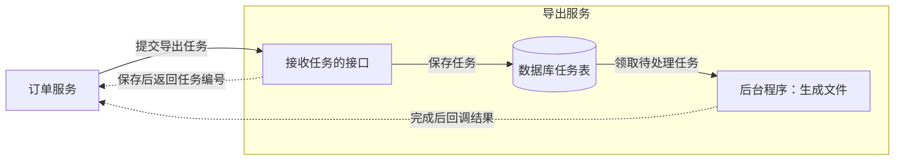
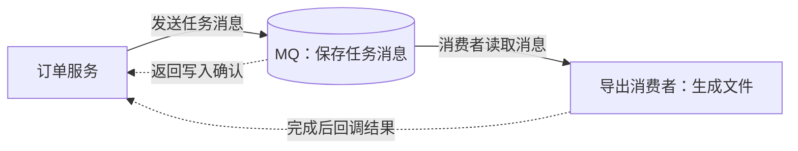
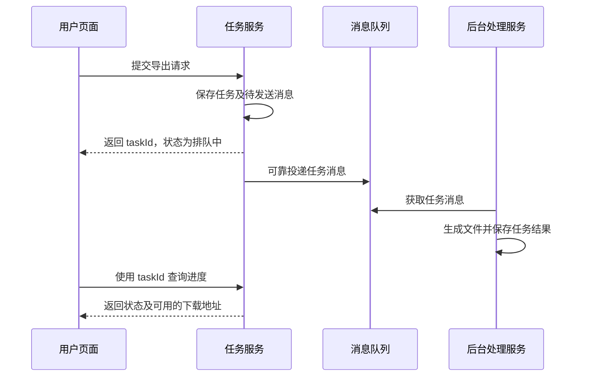
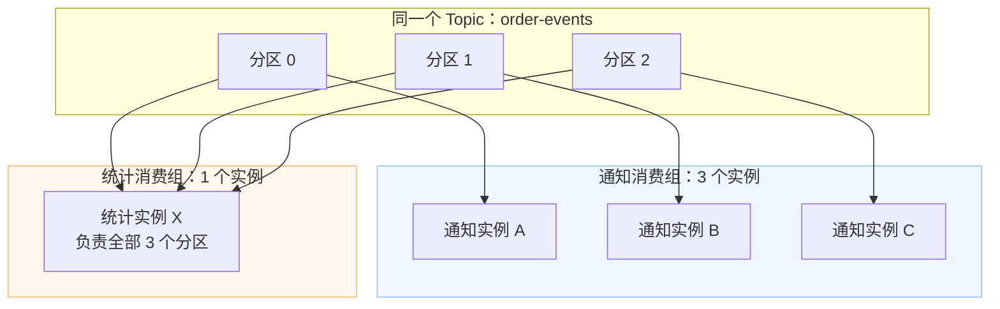
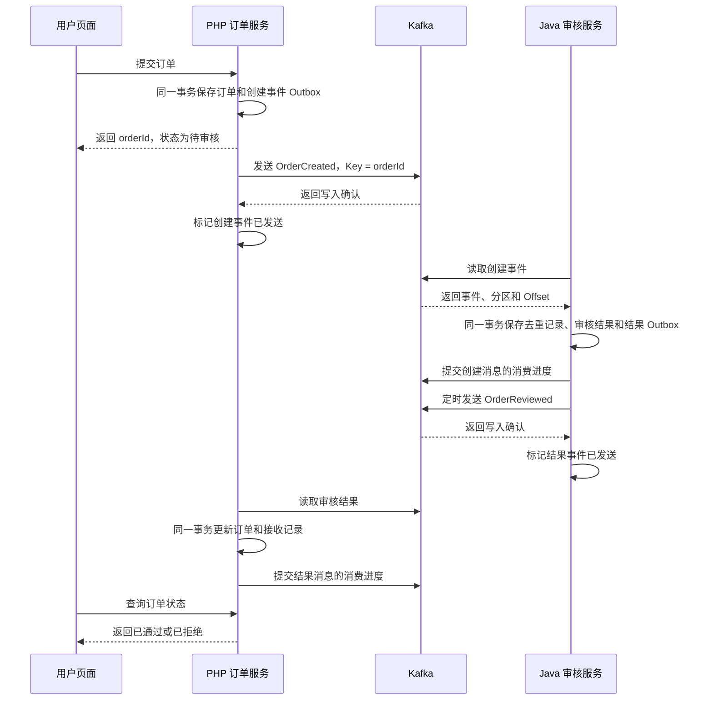
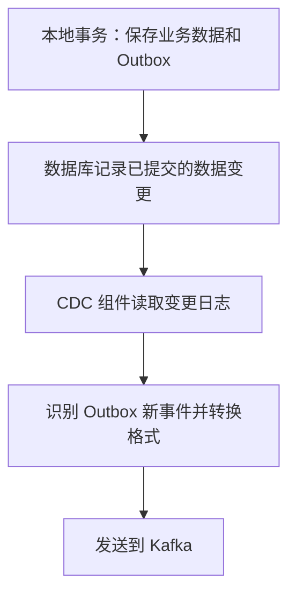

# 消息队列与 Kafka：从概念到可靠消息传递

> [!TIP]
> **GitHub 演示仓库：[ZhaoJiSen/kafka-order-lab](https://github.com/ZhaoJiSen/kafka-order-lab)**
>
> 用 PHP → Kafka → Java → Kafka → PHP 观察订单流转。依赖安装、数据库初始化与启动命令见 [README](https://github.com/ZhaoJiSen/kafka-order-lab#readme)。

做前端时，我们通常沿着一次 HTTP 请求理解业务：用户点击按钮，页面调用接口，后端返回结果，页面展示成功或失败。

但在批量导出报表、处理上传文件、发送通知等场景中，后端可能先返回 “已受理” 的中间状态，再继续处理任务。此时，**请求成功只说明提交到了某一步，业务是否完成，还要看后续处理结果。**

消息队列常用于连接这些后台处理环节，Kafka 则是可以承担消息传递的技术之一。

## 1. 导出任务为什么要异步处理

假设一个管理后台需要导出大量记录。用户点击导出后，后端要查询数据、组装表格、生成文件，再把文件上传到存储服务，才能返回下载地址。

最直接的做法是让接口完成这些操作后，再返回下载地址：

```text
点击导出 → 发起 HTTP 请求 → 查询并生成文件 → 返回下载地址
                           页面一直等待
```

数据量变大后，文件还没生成，请求就可能超过网关或浏览器侧设置的超时时间。页面显示失败时，后台任务却可能仍在执行。用户再次点击导出，还可能创建一份重复任务。

因此，可以把“创建导出任务”和“完成导出任务”拆开：接口先保存任务，返回 `taskId`，后台再生成文件，页面按任务编号查询进度。

**异步处理解决“用户不用一直等”。至于后台任务由谁保存、怎样交给处理方、失败后如何继续，则是架构上需要另外决定的事。**

### 1.1 异步任务如何选择架构方案

选择之前，先看三个问题：**任务由谁负责？失败后能否恢复？处理能力是否需要独立扩容？**

| 方案 | 什么情况下适合 | 需要承担的工作 |
| --- | --- | --- |
| 内存队列＋后台线程 | 任务少，允许丢失或重新发起 | 与接口共享进程和资源 |
| 数据库任务表＋后台程序 | 当前业务自用，需要持久化和重试 | 自己维护任务领取与故障恢复 |
| 独立服务＋接口／回调 | 已有统一平台，服务关系固定 | 处理提交失败与回调失败 |
| 消息队列＋消费者 | 流量高峰、停机缓冲、多方订阅 | 维护 MQ、积压、重试与去重 |

上表先提供一个选型概览。理解消息队列的工作方式和 Kafka 的特点后，第 5 节会回到导出场景，展开比较这些方案。

## 2. 什么是消息队列

**消息队列（Message Queue，简称 MQ）让应用通过消息传递信息，并把发送和处理分开。** 发送方把消息交给消息系统，接收方再获取消息、执行相应业务。发送方不必一直等待接收方处理完成。

最基本的参与者有三个：

| 角色 | 含义 | 导出场景中的对应对象 |
| --- | --- | --- |
| 生产者（Producer） | 创建并发送消息的应用 | 创建导出任务的服务 |
| 消息系统 | 接收、保存并传递消息的基础设施 | 承载任务消息的中间件 |
| 消费者（Consumer） | 获取消息并执行处理的应用 | 生成导出文件的后台服务 |

消息可以是一段 JSON。下面这条消息表达的是“一份导出任务已经提交，请按这些条件处理”：

```json
{
  "eventId": "evt-demo-001",
  "eventType": "ExportRequested",
  "schemaVersion": 1,
  "taskId": "task-demo-001",
  "requestedAt": "2026-10-23T09:00:00+08:00",
  "filters": {
    "startDate": "2026-10-01",
    "endDate": "2026-10-22"
  }
}
```

消费者根据 `taskId` 找到任务，再按筛选条件生成文件。`eventId` 用来标识这条事件，`eventType` 说明发生了什么，`schemaVersion` 标明消息结构的版本。业务标识和事件标识承担不同作用，后面处理重复消息时还会用到。

消息里通常只放业务标识和必要参数。生成的大文件更适合保存在文件存储中，再通过文件标识或受控地址访问。

可以把这条消息看作一张交接单：发送方说明要做什么，处理方收到后执行。不过，消息如何保存、处理完成后如何确认、失败后如何恢复，仍要看具体消息产品和应用的设计。

参考：[AWS：What is a Message Queue?](https://aws.amazon.com/message-queue/)。

### 2.1 工作队列：一份任务交给一个实例处理

假设有三台服务负责生成文件，同一个任务通常只需要其中一台执行：

```text
                          ┌→ 导出实例 A
导出任务 → 工作队列 ────────┼→ 导出实例 B
                          └→ 导出实例 C
```

这三台实例负责同一类业务，目的是分担工作。正常情况下，一份任务交给其中一台处理，其他实例继续处理别的任务。发生故障或消息重投时，同一任务仍可能被再次执行，因此业务还要处理重复执行的问题。

### 2.2 发布订阅：同一个事件交给多个业务处理

如果业务发生“订单已创建”事件，通知系统、统计系统、搜索系统可能都要处理：

```text
                              ┌→ 通知系统
订单已创建 → 发布订阅消息系统 ────┼→ 统计系统
                              └→ 搜索系统
```

这时，通知、统计和搜索各有一份工作要做，每个系统都需要收到这条事件。如果把它们放进同一个竞争领取消息的队列，事件被通知系统取走后，另外两个系统就不能指望通过同一次分发也收到它。

两种方式的区别在于：**多个实例是在分担一份工作，还是多个业务需要各自处理同一个事件。** 同一款消息产品可能支持这两种方式。后文会看到，Kafka 用消费组来表达这种关系。

参考：[RabbitMQ：Work Queues](https://www.rabbitmq.com/tutorials/tutorial-two-python)、[RabbitMQ：Publish/Subscribe](https://www.rabbitmq.com/tutorials/tutorial-three-python)。

## 3. 引入消息队列带来的变化

### 3.1 将任务受理与后台执行分开

接口保存任务及待发送消息后，可以先返回任务编号；发送程序负责投递消息，消费者继续执行导出、转码等工作。用户能更早知道提交结果，但生成文件、完成转码需要的计算和存储工作并没有减少。前端因此需要分别展示“任务已提交”和“任务已完成”。

### 3.2 减少系统之间的直接调用

订单服务可以发布“订单已创建”，由关心这个事件的系统分别订阅。增加一个统计订阅方时，订单服务通常不必新增对该系统的直接调用。

发送方不必逐一调用所有下游系统，接收方仍需要理解它发出的消息。双方要约定事件含义、字段结构和兼容规则，否则消息能收到，业务也可能处理错。

### 3.3 为什么消息队列能缓冲流量高峰

**关键是把“接收任务”和“执行任务”分开，并限制消费者同时执行的任务数量。**

生成报表需要查询数据库、组装 Excel、上传文件；接收任务消息只需要保存“哪个任务需要执行”等必要信息。两者消耗的时间和资源不同。如果每收到一个请求就立即启动导出，大量任务会同时查询数据库、占用内存，可能把服务或数据库压垮。

使用队列后，先保存尚未处理的任务，消费者再按可承受的速度执行：

```text
每秒提交 1,000 个任务
          ↓
消息队列保存尚未处理的任务
          ↓
导出集群控制并发，每秒处理 200 个任务
```

假设队列能够承接这个提交速度，高峰持续 10 秒，导出集群每秒稳定完成 200 个任务；高峰结束后没有新任务。忽略启动等开销，任务数量大致如下：

| 阶段 | 新提交 | 本阶段完成 | 剩余待处理 |
| --- | --- | --- | --- |
| 高峰期间的 10 秒 | 10,000 个 | 2,000 个 | 8,000 个 |
| 高峰结束后的 40 秒 | 0 个 | 8,000 个 | 0 个 |

**削峰把瞬间的处理压力变成了更长的等待时间，任务本身的计算量并没有减少。** 数据库任务表配合受控的后台执行程序，也能实现这种排队处理。

加入 MQ 后，如果消费者仍无限制地启动任务，压力照样会传到数据库。队列的接收能力、容量和消息保留时间也有上限，需要根据积压限制任务进入速度。如果长期提交速度超过处理速度，积压会持续增长，仍需扩容、限流或降低单个任务的处理成本。[基于队列的负载均衡](https://learn.microsoft.com/en-us/azure/architecture/patterns/queue-based-load-leveling)

## 4. 什么是 Kafka

**Apache Kafka 是一个分布式事件流平台。** 它支持事件的发布与订阅、持久保存，并能配合流处理能力持续处理事件。业务中常把它作为消息中间件使用。[Apache Kafka 官方介绍](https://kafka.apache.org/intro/)

前面的 MQ 说明了应用为什么要通过消息协作。理解 Kafka 的具体做法，可以从它保存消息的方式入手：**消息按顺序追加到日志中，消费者读取后记录自己的进度，消息通常仍会保留。**

因此，通知系统读过一条订单事件，并不妨碍统计系统再读一次；应用需要重新处理历史事件时，也可以调整读取位置，前提是这些数据还在。

| 理解角度 | 传统任务队列的常见模型 | Kafka 常规消费组模型 |
| --- | --- | --- |
| 关注重点 | 把待办任务交给处理者 | 保存事件流，并让不同应用持续读取 |
| 处理完成后 | 确认后通常从队列移除 | 提交消费进度，记录仍按保留策略保存 |
| 多实例协作 | 多个工作实例竞争处理任务 | 同组实例分担分区 |
| 多个业务各自读取 | 通常配置各自的队列或订阅 | 通常使用不同消费组 |
| 重新读取 | 取决于产品与队列类型 | 可调整读取位置，但数据必须仍然存在 |

表中比较的是传统任务队列和 Kafka 常规消费组的常见工作方式。RabbitMQ 也提供流存储能力，Kafka 也有其他消费方式，选型时仍要看具体功能和配置。本文后续都按常规消费组模型解释。

## 5. 回到导出场景：如何选择和组织这些服务

前面已经介绍了消息队列的工作方式、削峰原理和 Kafka 的特点。现在回到导出任务，具体比较任务由谁保存、失败后怎样继续，以及结果怎样通知调用方。

内存队列实现简单，但任务如果只在内存中，进程退出后可能丢失。

“服务自己维护”不等于“任务只放在内存里”。如果任务不能因为重启而丢失，可以先写入数据库，再由后台执行程序领取。对于规模可控、只由当前业务负责的任务，这种方案可能已经足够。

独立任务服务适合集中管理任务和独立扩容，但需要先持久化任务，再确认受理；调用双方还要约定提交重试、回调重试和去重。

“异步回调”和“消息队列”也可以同时使用：**消息队列决定任务怎样交给处理方，回调决定处理完成后怎样通知调用方。** 通过 MQ 执行的任务，完成后同样可以回调；也可以保存结果，让调用方查询。[异步请求与响应模式](https://learn.microsoft.com/en-us/azure/architecture/patterns/asynchronous-request-reply)

### 5.1 什么情况下值得引入消息队列

仍以导出为例，可以这样判断：

- **后台偶尔有人导出报表，任务由当前系统负责：** 可以先用数据库任务表和后台执行程序，自己保存状态、失败重试。
- **公司已经有统一导出平台：** 调用它的任务接口，由平台保存和执行，完成后回调或提供查询接口。平台能可靠受理时，不必仅因为“异步”再增加一层 MQ。
- **多个业务在高峰期集中提交导出任务：** 如果需要让任务先排队、处理集群按能力执行，或在处理服务发布期间继续接收任务，可以考虑 MQ。
- **订单创建后，通知、统计、搜索都要各自处理：** 可以发布订单事件，让不同系统独立订阅，减少订单服务逐一调用下游的代码。

**MQ 的核心价值，是让消息独立于业务进程保存，支持可靠交接和故障后继续处理，并让发送方与处理方按各自的节奏运行。** 在消息系统可用且能接收消息时，发送方不要求处理方此刻在线；双方仍然需要约定消息含义和格式。

这里的“可靠”需要发送确认、副本和保留策略、失败重试、业务幂等共同保证。持久化消息不等于业务一定执行成功，也不代表消息永远保留。高峰可以先积压，但长期处理不过来，仍需扩容或限流。[基于队列的负载均衡](https://learn.microsoft.com/en-us/azure/architecture/patterns/queue-based-load-leveling)、[Kafka Introduction](https://kafka.apache.org/42/getting-started/introduction/)

### 5.2 独立任务服务与 MQ，区别在哪里

**独立任务服务也能应对流量高峰，前提是先保存任务，再控制后台执行速度。MQ 则把消息保存和交接能力独立出来，供不同业务使用。**

下面两张图分别画出任务怎样被保存、执行，以及结果回调给谁。实线表示任务流向，虚线表示受理回复或结果通知。

**方案一：导出服务自己维护任务**



**方案二：通过 MQ 交给导出消费者**



第 3.3 节说明了削峰的关键：先保存任务，再控制执行速度。对照这两张图可以看到，数据库任务表和 MQ 都可以承担排队的作用；区别在于谁负责保存和交接任务。

图中的“写入确认”只表示消息已按配置被接收，不表示导出已经完成；“完成后回调结果”才是业务处理结束后的通知。

| 对比 | 任务服务＋数据库任务表 | MQ＋消费者 |
| --- | --- | --- |
| 任务先交给谁 | 任务服务的接口 | 消息系统 |
| 任务服务暂时停机 | 调用方保留任务，之后重试 | MQ 可用时先保存，恢复后消费 |
| 如何领取与恢复任务 | 自己实现领取、并发控制和超时恢复 | 使用消费机制，补充业务重试与去重 |
| 多个系统各自处理事件 | 自己维护分发与各方进度 | 使用独立订阅或消费组 |

两种方案都需要保存业务状态、处理失败和避免重复执行。区别在于，这些任务交接能力是由业务服务自己建设，还是借助消息中间件。独立任务服务内部也可以使用 MQ，两者可以组合。

如果只有一个导出平台、规模可控，数据库任务表可能就够了；当多个业务需要统一传递消息、隔离处理服务停机的影响，或让多个系统独立订阅事件时，MQ 的价值会更明显。

### 5.3 选择 MQ 后，导出任务如何流转

下面以“消息队列＋后台处理服务”为例。它是一种架构选择，并非所有异步导出都必须采用：



拆开之后，创建任务的服务先保存任务，返回 `taskId`；后台处理服务通过消息得知有任务需要执行，生成文件后再保存结果。页面凭 `taskId` 查询状态，不必让一次 HTTP 请求一直等到文件生成。

在这条链路中，消息队列负责传递 “需要执行哪个任务”。任务是否排队、是否完成、下载地址是什么，仍由业务服务保存并对外提供。

图中的 “保存任务及待发送消息” 和 “可靠投递” 需要服务端设计来保证。只做“先保存任务，再发一次消息”，仍可能遇到任务保存成功、消息发送失败的情况。

## 6. Kafka 核心概念

生产者把订单事件写入一个 Topic。Topic 按分区保存消息，分区中的每条消息都有一个位置编号。消费者以消费组的身份读取这些分区，并保存读取进度。

Topic、Partition、Offset 和 Consumer Group 分别对应这条链路中的不同对象：

| 概念 | 作用 |
| --- | --- |
| **Topic（主题）** | 按业务组织消息，例如 `order-events` 存放订单事件。 |
| **Partition（分区）** | Topic 下的一份有序日志，也是并行处理的基本单位；分区内有序，跨分区无全局顺序。 |
| **Offset（位置）** | 消息在分区内的编号。处理完 0～4 后提交 5，表示恢复时从位置 5 继续。 |
| **Broker（节点）** | 保存分区数据、处理消息读写的 Kafka 服务节点；多个节点组成集群。 |
| **Consumer Group（消费组）** | 同组实例分担分区，不同组独立读取并维护各自进度。 |
| **Retention（保留策略）** | 决定数据如何清理；消费完成不会立即删除消息，重读范围受保留和清理策略限制。 |

### 6.1 分区决定消息放在哪里

一个 Topic 可以有多个分区，每个分区维护自己的消息顺序和 Offset。不同分区都可能出现 Offset `0`，所以定位一条消息时，需要同时知道 Topic、分区和 Offset。

以订单事件为例，生产者使用 `orderId` 作为 Key，在分区数和分区规则保持一致时，同一订单的事件会进入同一分区。Kafka 保证分区内的记录顺序；应用如果把业务处理并发执行，仍要自行保证处理顺序。

### 6.2 消费组决定谁来处理

通知服务可以用 `notification-group`，统计服务可以用 `analytics-group`。它们订阅同一个 Topic，各自读取事件、维护进度，互不代替。

通知量增加后，可以为通知组再启动几个实例。同组实例会分担分区，而不同组仍独立读取。这就对应了第 2 节的两种分发方式：组内分担工作，组间各自订阅。

下面假设 `order-events` 有 3 个分区。通知组启动 3 个实例，统计组只启动 1 个实例。箭头表示读取关系，消息由消费者主动拉取。



- **组内分担：** 通知组的 A、B、C 分别读取一个分区，共同完成通知业务。
- **组间独立：** 统计实例 X 也读取这 3 个分区，通知组读过的消息，统计组仍能读取。
- **进度各自保存：** 通知组处理得快，不会替统计组推进消费位置；统计组暂停，也不要求通知组一起暂停。

在常规消费组的稳定分配期间，一个分区由组内一个实例负责。三个分区最多分给同组的三个实例；再增加实例，也不会让第四个实例获得额外分区。组成员变化时，分区可能重新分配，这个过程叫 Rebalance。

参考：[Kafka Introduction](https://kafka.apache.org/42/getting-started/introduction/)、[Kafka Design](https://kafka.apache.org/42/design/design/)、[Topic Configs](https://kafka.apache.org/42/configuration/topic-configs/)。

### 6.3 分区是存储结构，消费者实例是运行中的程序

可以把一个分区理解为 Topic 下持续追加记录的一份日志。分区里保存消息，不会执行订单审核；真正执行业务的是消费者程序。

```text
Topic：order-events
  Partition 0：[订单 A 创建] → [订单 C 创建]
  Partition 1：[订单 B 创建] → [订单 B 付款]
  Partition 2：[订单 D 创建]

消费组中的实例 A 读取 Partition 0、1
消费组中的实例 B 读取 Partition 2
```

一条普通消息只写入其中一个目标分区。分区副本用于可靠保存同一份日志，不表示业务要再执行一遍。消费者实例则是启动起来的一份程序进程；它可以负责多个分区，也可以因实例多于分区而暂时没有分区可读。

分区归属于具体 Topic。`order-events` 的 Partition 0 和 `payment-events` 的 Partition 0 是两份独立日志，不能只用分区编号定位消息。[Kafka Introduction](https://kafka.apache.org/42/getting-started/introduction/)

### 6.4 分区数量先配置，扩容需要明确操作

创建 Topic 时可以指定分区数；如果走自动创建，则使用相应默认配置。“有三个分区”是这个 Topic 的配置，不是 Kafka 固定只能有三个分区。

消息变多时，Kafka 不会因为日志写满一段就自动多创建一个业务分区。运维或管理工具可以增加分区数；增加后，原有消息不会自动重新分布到新分区。Kafka 常规管理操作不支持直接减少已有 Topic 的分区数。

扩分区还可能改变后续消息的 Key 路由。例如按 Key 哈希和分区数选择分区时，分区数从 3 改成 6，同一个订单的新事件可能进入不同编号的分区。历史事件仍在原分区，需要额外考虑跨分区的处理顺序。[Basic Kafka Operations](https://kafka.apache.org/42/operations/basic-kafka-operations/)

### 6.5 谁决定消息进入哪个分区

发送端通常先由生产者客户端选择目标分区，再发给负责该分区的 Broker。可以分成三种情况理解：

| 发送方式 | 分区如何决定 |
| --- | --- |
| 显式指定分区 | 按调用时提供的分区编号发送 |
| 提供 Key，未指定分区 | 通常按客户端的分区规则，根据 Key 计算 |
| 未提供 Key，也未指定分区 | 使用客户端配置的无 Key 分区策略 |

Kafka Java 客户端的默认规则在有 Key 时按 Key 哈希选择分区。其他客户端和自定义分区器可能采用不同规则，无 Key 时也不能一概理解成逐条轮询。[Producer Configs](https://kafka.apache.org/42/configuration/producer-configs/)

消费者不会决定生产者把消息写到哪里。消费组的分区分配，是消息已经保存后，决定组内哪个消费者负责读取哪些分区的另一件事。

同样是 `OrderCreated` 的两条消息，如果 Key 分别是订单 A 和订单 B，可能进入不同分区。`eventType` 只有在业务明确把它用作 Key 或写入自定义路由规则时，才参与分区选择。

### 6.6 Key、eventId 和 Offset 是三种不同的标识

| 标识 | 谁提供 | 用途 | 是否自然递增 |
| --- | --- | --- | --- |
| Key，例如 `orderId` | 应用发送消息时提供 | 参与分区选择，把同一业务对象的消息关联起来 | 不要求 |
| `eventId` | 应用定义在消息内容中 | 标识一次业务事件，供去重和追踪使用 | 不要求 |
| Offset | Kafka 追加日志时分配 | 表示记录在某个分区中的位置 | 按分区日志向后推进 |

Offset 的分配与 `eventType` 无关。假设某个分区连续收到三条普通业务记录：

```text
Partition 1
  Offset 7：OrderCreated，订单 A
  Offset 8：OrderCreated，订单 B
  Offset 9：OrderPaid，订单 A
```

进入同一分区的记录，共用这个分区的位置序列。这里的“下一条加一”帮助理解普通日志追加；压缩、事务等机制可能让消费者看到的业务记录位置存在间隔，不能把 Offset 差值始终当作消息条数。[KafkaConsumer：Offsets and Consumer Position](https://kafka.apache.org/42/javadoc/org/apache/kafka/clients/consumer/KafkaConsumer.html)

### 6.7 记录的 Offset 与消费者的进度要分开

一条已经存在的记录，例如 `order-events / Partition 1 / Offset 7`，其位置不会因为某个消费者回退而重新编号。

消费者有当前读取位置，也有已提交的恢复位置。假设它已成功处理 Offset 7，提交 8，表示下次从位置 8 继续。若它读到后面但尚未提交就退出，恢复后仍可能从之前提交的位置重读。应用也可以显式调整当前读取位置，或在适当条件下重置消费组的已提交位置。

“Offset 回滚”在讨论业务时，通常指的是消费位置回退，应明确回退的是哪种位置。主动 seek 当前读取位置，不等于已经改写消费组的持久进度。[KafkaConsumer](https://kafka.apache.org/42/javadoc/org/apache/kafka/clients/consumer/KafkaConsumer.html)

### 6.8 重新读取消息，不会让数据库回到过去

消费者从 Offset 20 回退到 10，只会再次取得仍然保留的旧消息。它随后查询业务数据库，拿到的是数据库当时的当前状态，而不是“Offset 10 时刻的数据库快照”。

例如订单已经审核通过，重读旧的“订单已创建”事件，不应把订单自动改回待审核。接收方需要检查事件是否处理过、当前状态是否允许转换，以及消息版本是否过旧。

如果确实要撤销审核、退回库存或退款，需要明确的业务补偿操作。若要重建历史状态，则要事先具备完整事件、历史数据和可重复的重建规则；仅有 Kafka Offset 无法提供这些能力。

数据也不是一直可重读：超出保留时间、容量范围，或经过日志压缩后，所需历史记录可能已经不存在。[Topic Configs](https://kafka.apache.org/42/configuration/topic-configs/)

## 7. 用一笔订单看完整链路

前面用导出任务解释了为什么要异步、什么时候值得引入 MQ。下面换成可以实际运行的订单案例，把分区、消费进度和数据库操作连起来。

这个案例由 PHP 创建订单，Java 按金额审核，再由 PHP 保存最终状态。总额不超过 1000 元通过，超过则拒绝。**PHP 和 Java 各自使用独立数据库，通过 Kafka 交换事件，不直接修改对方的表。**



图中画出一种正常执行次序。实际运行时，Outbox 发送程序独立调度；关键约束是先提交本地数据库事务，再提交消费进度或发送已保存的事件。

### 7.1 谁负责执行这些步骤

| 程序 | 负责什么 | 怎样运行 |
| --- | --- | --- |
| PHP HTTP 服务 | 保存、查询订单 | `php artisan serve` |
| PHP Outbox 发送进程 | 查询待发送创建事件并投递 | `php artisan demo:publish-outbox` |
| Java 审核服务 | 消费创建事件、审核、定时发送结果 | 一个 Spring Boot 进程 |
| PHP 结果消费进程 | 读取结果并更新订单 | `php artisan demo:consume-results` |

PHP 的三个进程共用一套代码和数据库。Java 的监听器和定时发送任务由 Spring 管理。生产者和消费者是程序承担的职责：Java 既消费 `OrderCreated`，又生产 `OrderReviewed`。

### 7.2 三种“成功”，分别说明什么

| 看到的结果 | 已经完成了什么 | 还有什么可能没完成 |
| --- | --- | --- |
| 下单接口返回已受理 | PHP 已保存订单和待发送事件 | 创建事件可能还没发给 Kafka |
| 生产者收到写入确认 | Kafka 写入满足了配置的确认条件 | Java 可能还没开始审核 |
| 消费者处理完并提交进度 | 应用已完成本地业务，并推进该组恢复位置 | 另一端可能还没收到结果 |

例如 `acks=all` 等待当前同步副本集合的确认，不会等待 Java 审核或 PHP 更新订单。**提交位置是消费者报告的进度，Kafka 不会代替程序检查数据库业务是否完成；本案例通过代码保证先保存业务，再提交进度。** [Kafka Producer Configs](https://kafka.apache.org/42/configuration/producer-configs/)

## 8. 订单流转失败了，怎么接着处理

正常流程只说明“每一步都成功时会怎样”。要让消息链路可靠，还要逐个回答：保存失败怎么办、没发出去怎么办、重复收到怎么办，以及处理不动时怎么办。

### 8.1 数据库保存失败：本地事务保证一起提交

先看两端各自需要一起保存的内容：

| 发生在哪一步 | 同一事务中的修改 | 某一步失败时 |
| --- | --- | --- |
| PHP 创建订单 | 订单＋创建事件 Outbox | 一起撤销，不留下只有订单、没有事件的状态 |
| Java 审核 | 已处理事件记录＋审核结果＋结果 Outbox | 一起撤销，不把本次审核当作完成 |
| PHP 更新订单 | 订单最终状态＋结果接收记录 | 一起撤销，不提前记为已处理 |

PHP 用 `DB::transaction(...)`，Java 用 `@Transactional(rollbackFor = Exception.class)`。它们组织的是**本地数据库事务**：只能让各自数据库里的修改一起提交或回滚，不能让 PHP、Kafka、Java 整条链路一起回滚。Java 方法经事务代理成功提交后，监听器才提交 Kafka 消费进度。[Spring 事务回滚说明](https://docs.spring.io/spring-framework/reference/data-access/transaction/declarative/rolling-back.html)

### 8.2 数据库保存成功，消息没发出去：Outbox 留下发送依据

订单保存之后，Kafka 可能暂时不可用。如果只在内存里记着“稍后发一条消息”，程序退出后就可能忘掉这件事。

Outbox 是数据库里的待发送消息表。创建订单时把事件一起存下来，独立发送程序后续再投递：

```text
本地事务：保存订单＋保存待发送事件
                 ↓
发送程序读取 Outbox，发送给 Kafka
                 ↓
收到写入确认，再标记已发送
```

发不出去就保留记录，恢复后继续尝试。但下面两个操作仍然是分开的：

```text
① Kafka 已保存消息，返回确认
② 发送程序把数据库里的 sent_at 更新为“已发送”
```

如果程序在①之后、②之前退出，**消息已经在 Kafka 中，Outbox 却仍显示未发送**。程序恢复后会再次发送，因此消费者可能收到重复消息。这也是需要幂等的原因。[Transactional Outbox 模式](https://microservices.io/patterns/data/transactional-outbox.html)

### 8.3 消息重复了：用事件编号和业务状态保护结果

“同一事件又收到一次”和“同一订单又来了另一条创建通知”需要分别处理：

| 检查什么 | 用来识别什么 | 本案例的做法 |
| --- | --- | --- |
| 请求幂等键 | 用户是否重试了同一次下单 | PHP 复用原订单；内容变化则拒绝 |
| `eventId` | 同一事件是否已经处理 | Java 查 `processed_events`，PHP 查 `message_receipts` |
| `orderId` 与订单状态 | 同一业务对象是否已经完成 | Java 不重复审核；PHP 只更新待审核订单 |

例如，`evt-1 / ord-A` 再次到达，事件去重即可拦住；如果上游因业务错误另外创建了 `evt-9 / ord-A`，事件编号不同，就需要订单层面的检查，避免再次审核。

创建事件和审核结果事件表达不同的事，因此各有一个 `eventId`，但沿用同一 `orderId`。**重试发送同一份已保存的 Outbox 消息时，复用原 eventId，不在每次发送时重新生成。**

去重记录与业务修改一起提交，并用数据库主键或唯一约束限制重复记录，不能只依赖“先查一下”。本 Demo 按单实例运行；扩展多实例时，还需要处理并发冲突和外部调用的幂等。[幂等消费者模式](https://microservices.io/patterns/communication-style/idempotent-consumer.html)

### 8.4 前一条一直失败，后面的消息会不会被堵住

先区分两个位置：

| 堵在哪里 | 消息在哪里 | 当前项目的行为 |
| --- | --- | --- |
| Outbox 发送失败 | 数据库中，可能尚未写入 Kafka | 保留记录，下一轮发送；Java 本轮遇错后结束循环 |
| Java 消费后审核失败 | Kafka 中 | 对可重试异常，间隔 1 秒继续尝试 |

Java 配置了 `FixedBackOff(1000, FixedBackOff.UNLIMITED_ATTEMPTS)`。这是 **Spring Kafka 的重试策略**，并非 Kafka 自动把失败消息移到队尾。

假设分区 0 有三条记录，应用按顺序处理：

```text
Offset 10：订单 A，处理失败，原位置重试
Offset 11：订单 B，等待
Offset 12：订单 C，等待
```

在这种阻塞重试策略下，A 一直失败，同分区后面的 B、C 就会等待。Kafka 仍可以接收新消息，但该消费组的积压会增加。其他分区由独立消费者线程负责时可以继续；如果共用同一个线程，也会受到卡住或重试等待的影响。**三个分区不等于三个处理线程。** 当前 Demo 未显式增加 Java 消费并发，默认一个消费者线程。[Spring Kafka 错误处理](https://docs.spring.io/spring-kafka/reference/3.3/kafka/annotation-error-handling.html)

另外，**抛出异常后才能进入重试；某次调用一直不返回，需要先用超时结束等待。** 长时间不再拉取消息，超过 `max.poll.interval.ms` 等条件后可能触发分区重新分配；换一个消费者并不能自动修好坏消息。[Kafka Consumer Configs](https://kafka.apache.org/42/configuration/consumer-configs/)

实际业务通常按失败原因决定怎么继续：

| 情况 | 可以采用的处理 | 需要接受的代价 |
| --- | --- | --- |
| 短暂数据库或网络故障 | 原位置有限次数重试 | 后续消息等待 |
| 需要较长时间后再试 | 转入重试 Topic，交给专门消费者 | 后来的消息可能先完成 |
| 数据错误、反复尝试无效 | 转入死信 Topic，告警并修复 | 需要补偿与重新处理流程 |
| 业务必须严格保持顺序 | 暂停受影响分区，解决后再继续 | 保留顺序，但处理延迟增加 |

重试 Topic 和死信 Topic 都需要应用或框架配置，不是 Kafka 自动判断业务失败后替我们创建。将失败消息移走后继续处理，会改变原有的业务完成顺序，必须确认业务能否接受。[Spring 非阻塞重试](https://docs.spring.io/spring-kafka/reference/3.3/retrytopic/how-the-pattern-works.html)

本 Demo 为了观察失败记录，保留了无限重试，没有实现上述完整治理。PHP 本机结果消费者遇异常会退出，需要修复并手动重启；容器模式才有配置好的进程重启策略。

### 8.5 允许短暂不一致，但要能发现长期未完成

Java 已审核通过、PHP 尚未收到结果时，两边会短暂显示不同状态。结果被 PHP 成功处理后，订单从“待审核”变成“已通过”。这就是本案例的最终一致性。

**“最终会一致”需要恢复条件，不能只靠一直等。** 服务需要恢复，消息仍须可用，错误也要能够解决。生产环境还需要观察：

| 要观察什么 | 可能说明什么 | 后续动作 |
| --- | --- | --- |
| Outbox 最老未发送记录的等待时间 | 发送程序停了，或 Kafka 持续不可用 | 告警，恢复发送并核对结果 |
| 消费积压和最老消息等待时间 | 处理能力不足，或失败消息阻塞 | 判断瓶颈，限流、扩容或隔离错误 |
| 长期待审核订单 | 某个交接或处理环节未完成 | 按订单追踪消息，进行对账与补偿 |
| 重试和死信数量 | 同类错误持续出现 | 修复原因，再受控重放 |

PHP 与 Java 的数据库状态、Kafka 的消费进度需要一起看。Offset 已提交不能单独证明整个跨服务业务结束。本仓库提供教学观察能力，尚未实现生产告警、自动对账和人工补偿平台。

### 8.6 Outbox 一定要定时查表吗？也可以用 CDC

本案例按条件、分批查询未发送记录，这叫**轮询发送（Polling Publisher）**，不是遍历整个数据库。轮询本身是正式的架构方案；是否合适，要看查询压力、发送延迟和维护成本。

如果希望减少反复查表，可以保留“业务数据与 Outbox 一起提交”，把发送环节换成 **CDC（变更数据捕获）**：



MySQL 的 binlog、PostgreSQL 的 WAL 可以作为这类采集的数据来源。Debezium 提供 Outbox Event Router，能把捕获到的 Outbox 事件转换成 Kafka 消息，并按配置设置 Topic、Key 和正文。它接管的是“发现并发送已保存事件”的工作，不替代业务事务，也不替代消费者幂等。[事务日志读取模式](https://microservices.io/patterns/data/transaction-log-tailing.html)、[Debezium Outbox Event Router](https://debezium.io/documentation/reference/stable/transformations/outbox-event-router.html)

| 发送方式 | 怎样发现新事件 | 主要取舍 |
| --- | --- | --- |
| 定时查询 Outbox | 按状态批量查表 | 实现简单，有查询开销和轮询等待 |
| 提交后唤醒＋轮询兜底 | 提交后立即通知发送，遗漏的记录由轮询补上 | 等待较少，要维护两条触发路径 |
| Outbox＋CDC | 跟踪数据库变更日志 | 减少查表，需要维护采集组件和读取进度 |

只在提交后发一个内存通知仍可能遗漏，所以第二种方案保留数据库记录和轮询兜底。CDC 也可能重复投递，仍要保留 `eventId` 和业务幂等，并监控采集延迟、日志保留与故障恢复。

**专业架构的关键是交接有依据、失败可恢复、状态可观察，而不是单纯消除定时任务。** 本 Demo 的 SQLite / H2 轮询方案没有直接接入 Debezium；这里介绍的是选用受支持数据库和采集组件后的演进方向。
